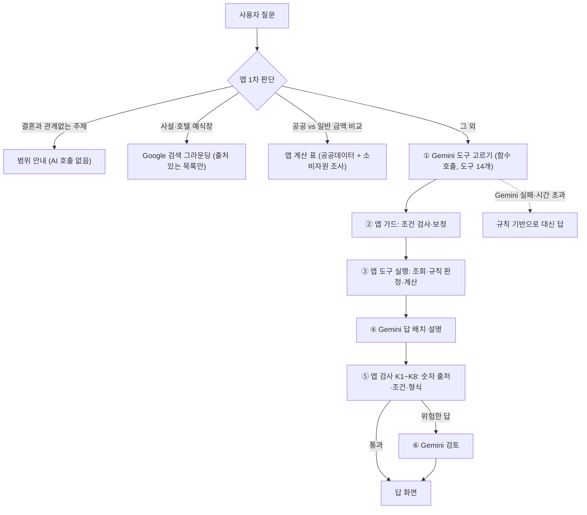
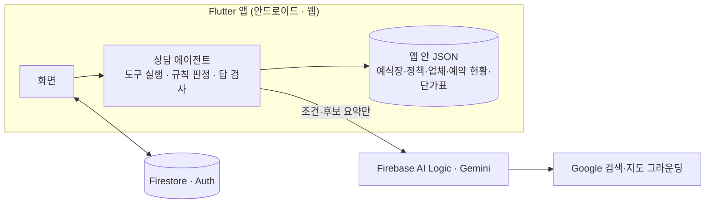

# We Connect

**청년 결혼지원 통합플랫폼.** 공공예식장·결혼 지원 정책·웨딩 업체를 한곳에서 찾고, AI 상담으로 내 조건에 맞는 답을 받는 결혼 준비 앱입니다.

2026 대한민국 청년 CAREER FAIR AI 해커톤 (주제: AI 에이전트로 푸는 청년의 일·생활 문제) 출품작입니다.

- 웹 앱 (아이폰·PC): https://wedding-collect.web.app
- 안드로이드: 제출한 APK(`WeConnect-1.0.0.apk`)로 설치
- 아이폰은 사파리에서 웹 앱을 열고 "홈 화면에 추가"를 누르면 앱처럼 쓸 수 있습니다.

## 왜 만들었나

- 결혼 비용 부담이 크지만, 대관료가 싼 **공공예식장은 전국 240곳이 지역마다 신청 방법(36가지)이 달라** 찾기 어렵습니다.
- 웨딩 업체 가격은 공개되지 않은 경우가 많고, 결혼 지원 정책은 지역·나이·혼인 기간·소득 조건이 제각각입니다.
- 무엇부터 해야 할지 모르는 예비부부가 조건만 알려 주면 맞는 예식장·정책·준비 순서를 바로 받을 수 있게 했습니다.

## 주요 기능

| 화면 | 할 수 있는 일 |
|---|---|
| 홈 | 무료 공공예식장·내 조건 정책 배너, 바로가기, 맞춤 지원 찾아보기(거주지역·결혼 단계·예식일) |
| 예식장·업체 찾기 | [공공예식장 \| 웨딩업체] 전환. 지역 여러 곳 선택, 무료만 보기, 예약 현황 달력, 위치 지도, 근처 실제 연계 업체 / 업체 가격 비교·상담 신청(시연) |
| 맞춤 지원 정책 | 내 상황(지역·나이·예식일·초혼·무주택·소득)으로 정책 177건 자격 판정 |
| 예식 준비 체크리스트 | D-day, 예식일 기준 할 일·캘린더, 예산 현황, 항목별 담은 곳·계약·금액 |
| AI 상담 | 질문하면 앱 데이터로 찾고 판정한 결과를 카드·표로 정리. 공공 vs 일반 예식장 금액 비교, 파트너에게 공유 |

## AI는 어떻게 쓰나

**원칙: 판단은 데이터와 규칙, 설명은 AI.** 가격·정원·예약 가능 여부·정책 대상 판정은 앱이 공공데이터와 규칙으로 계산하고, AI(Gemini)는 질문을 이해해 도구를 고르고 결과를 설명하는 역할만 합니다. 모르는 값은 지어내지 않고 "문의 필요"와 문의처를 보여 줍니다.



| 구분 | 내용 |
|---|---|
| 모델 | Google Gemini 3.5 Flash-Lite (`gemini-3.5-flash-lite`), Firebase AI Logic(Gemini Developer API) |
| 함수 호출 도구 14개 | 예식장 검색·예식장 정보·정책 검색·업체 검색·비용 추정·계산·준비 일정·종합 추천·일반 안내·앞 목록 가리키기·더 보기·장소 근처·웹 찾기·관계없는 주제 |
| 그라운딩 | Google 검색(앱 데이터에 없는 사실, 출처 없으면 버림), Google 지도(장소 좌표만, 거리는 앱이 계산) |
| 검사 | K1 조건 밖 카드 제거, K2 조회 결과에 없는 숫자·이름 차단, K3 반복 안내, K4 빈 값 문의처, K5 형식, K6~K8 제목·카드·범위 일치 |
| 실패 대응 | Gemini 실패·시간 초과·사용 한도 오류 시 규칙 기반 이해와 기본 틀로 답 |
| 평가 | 예상·탐색 질문 173턴을 실제 Gemini로 채점: 정답 88/95, 숫자·형식 검사 173/173 (2026-11-21, `docs/ai-eval/full_2026-11-21.md`). 틀린 턴은 고친 뒤 재평가 통과 |

자세한 설계는 `docs/ai-design/`, 평가 결과는 `docs/ai-eval/`에 있습니다.

## 데이터

| 데이터 | 출처 | 규모 |
|---|---|---|
| 공공예식장 | 공유누리(eshare.go.kr), 서울마이웨딩, 각 기관 안내 페이지 | 240곳 (상세 231곳) |
| 예약 현황 | 공유누리·서울마이웨딩 공개 예약 달력 | 174곳, 2026-11~2027-12, 11/19 수집 |
| 결혼 지원 정책 | 복지로, 온통청년, 각 지자체 공고 | 177건 |
| 연계 업체 | 전국 공공예식장 연계업체 현황 (직접 수집) | 103곳, 예식장 매칭 1,920건 |
| 일반 예식장 가격 | 한국소비자원 참가격 결혼서비스 예식장 가격정보 | 17개 지역, 2026년 9월 조사 |
| 웨딩 항목 단가 | 서울시 더 아름다운 결혼식 표준가격표, 소비자원 참가격 등 (직접 정리) | 22개 항목 |

- 실제 업체에는 가짜 가격·후기를 만들지 않습니다. 가격·상담 예약 흐름은 이름 앞에 **[시연]**이 붙은 가상 업체로 보여 줍니다.
- 추정 비용은 "참고 단가표 추정", 웹 정보는 "확인 필요"로 표시합니다.

## 생성형 AI 활용 범위

| 무엇에 | 도구 | 표시 |
|---|---|---|
| AI 상담 답변·도구 선택·검토·일반 안내 | Gemini 3.5 Flash-Lite | "일반 안내 · 앱 데이터 아님", "웹 정보 · 확인 필요" 배지 |
| 예약 달력 없는 예식장의 가능일 판단 보조 | Gemini 3.5 Flash-Lite | 판단 어려움·정보 없음 따로 안내 |
| 예식장 예시 후기 483개 | Gemini 3.5 Flash-Lite | "AI로 작성된 후기, 실제 이용 후기 아님" |
| 분위기 사진(룩북·배너, 사진 없는 예식장 4곳) | AI 생성 이미지 | 출처 표에 기재 |
| 앱 아이콘 | AI 생성 이미지 | 출처 표에 기재 |
| 개발 보조 (코드·테스트·데이터 스크립트·배포) | Anthropic Claude Code | - |

## 개인정보 보호

- AI에는 이름·이메일·연락처를 보내지 않고, 질문 속 전화번호·이메일은 가려서 보냅니다. 조건과 후보 예식장 ID·요약만 보냅니다.
- 시연·평가는 가상 데이터로 했습니다. 부부 합산 연소득은 기기에만 저장합니다.
- 계정 문서는 본인만 읽고 쓸 수 있고(`firestore.rules`), Gemini는 App Check로 등록된 앱에서만 부를 수 있습니다.

## 기술 스택

- **앱**: Flutter 3.50 (Dart 3.14), 안드로이드·웹
- **백엔드**: Firebase Authentication · Cloud Firestore · App Check · Hosting · AI Logic
- **주요 패키지**: `firebase_ai`, `flutter_map`(OpenStreetMap), `video_player`, `url_launcher`, `shared_preferences`, `intl`
- **데이터 도구**: Python 3 표준 라이브러리 (`tools/`, 수집·변환·검증·평가 리포트 19개)



## 폴더 구조

```
lib/
  app/          앱 시작, 하단 탭, 시연 링크
  core/         테마, 공용 위젯, 지역·한국어 조사 도우미
  data/         모델, 저장소(JSON 읽기), 공유 상태, 계정 저장
  features/
    home/ browse/ venue/ vendor/ policy/ checklist/ intro/ auth/ favorites/
    chat/agent/   도구 고르기, Gemini 연결, 규칙 판정
    chat/answer/  답 블록, 앱 검사 K1~K8, 답 작성
assets/data/    예식장·정책·업체·예약 현황·단가표·소비자원 가격 JSON
tools/          수집·변환·검증·평가 Python 스크립트
test/           자동 테스트, AI 평가 질문 세트(test/eval)
docs/           AI 설계, 평가 결과, 데이터 검증 보고서
```

## 실행하기

```bash
flutter pub get

# 웹(Chrome)에서 실행
flutter run -d chrome --dart-define-from-file=secrets.json

# 테스트
flutter test

# 배포용 빌드
flutter build web --release --dart-define-from-file=secrets.json
python -I tools/web_postbuild.py     # 아이콘 글꼴 이름에 해시 (캐시 문제 방지)
flutter build apk --release --dart-define-from-file=secrets.json
```

- `secrets.json`은 저장소에 없습니다. Firebase 콘솔에 등록한 App Check 디버그 토큰을 `{"APP_CHECK_DEBUG_TOKEN": "..."}` 형식으로 직접 만들어 넣습니다. 없으면 Gemini 호출이 거절되고 규칙 기반으로만 답합니다.
- 데이터 변환: `python -I tools/convert_venues.py`, `convert_policies.py`, `convert_vendors.py`, `convert_options.py` (원본 엑셀은 저장소 밖에 있습니다).

## 사용한 외부 자원

| 자원 | 라이선스·조건 |
|---|---|
| Pretendard 글꼴 | SIL Open Font License 1.1 |
| OpenStreetMap 지도 타일 | ODbL (지도에 출처 표시) |
| Wikimedia Commons 참고 사진 | CC0·PD·CC BY·CC BY-SA (사진마다 저작자·라이선스 표시) |
| Best-Flutter-UI-Templates `hotel_booking` 화면 구조 참고 | MIT (판매·수익 목적 금지 문구 포함) |
| 공공예식장·정책·예약 현황·소비자원 가격 | 각 기관 공개 자료, 출처·확인 날짜 표시 |
